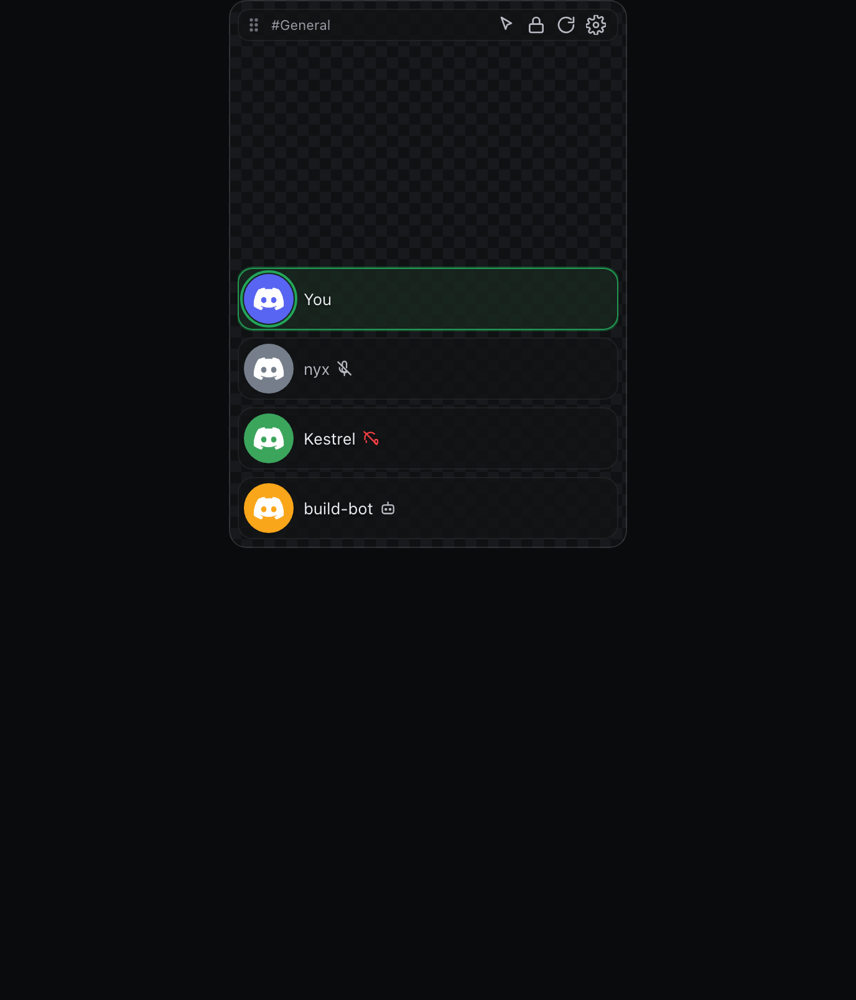
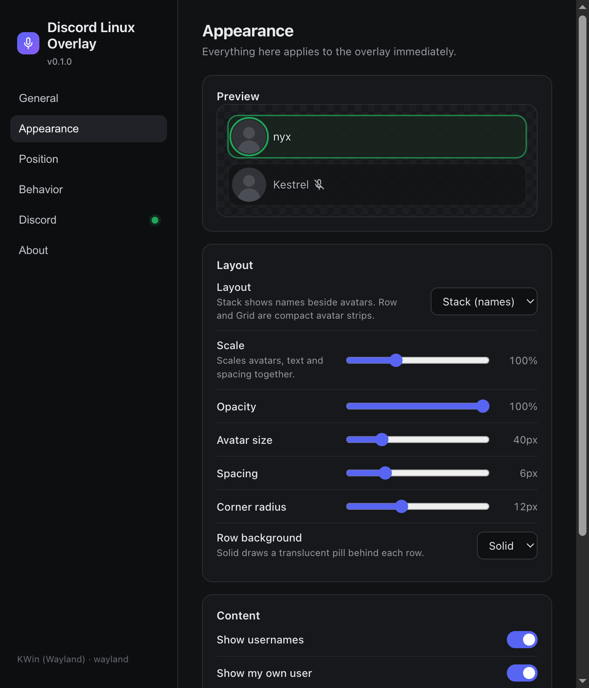
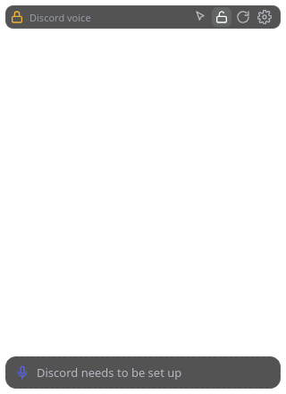
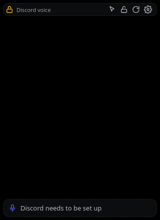

# Discord Linux Overlay

A transparent, movable Discord voice overlay for Linux, built for **KDE Plasma 6
Wayland** and **NVIDIA** — the setup where the original Overlayed installation
fails with `Failed to create GBM buffer: Invalid argument`.

It shows who is in your Discord voice channel, highlights the people who are
speaking, and marks who is muted or deafened, on top of games and applications.





*Screenshots were captured from the browser preview harness with simulated
participants (the headless build machine has no Discord client or desktop
session). See [TESTING.md](TESTING.md).*

> **Status: v0.1.0, early development.** The Discord IPC client, participant
> state machine and settings model are implemented and covered by automated
> tests (including an end-to-end fake-Discord session). The app has been **built
> and run on the target machine** (CachyOS, KDE Plasma 6 Wayland, RTX 3060): the
> overlay and settings windows open, the overlay surface is genuinely transparent,
> the CLI controls work, settings survive a restart and the tray item registers.
> **Discord itself is not yet verified**: Discord was not running and no Discord
> application credentials were configured, so no live voice session has been
> tested. Read [TESTING.md](TESTING.md) for exactly what was and was not tested.

## Features

- **Discord voice integration** over Discord's supported local RPC IPC socket —
  no token scraping, no memory reading, no third-party services.
- **Live speaking indicators** driven by Discord's `SPEAKING_START` /
  `SPEAKING_STOP` events (event driven, no polling).
- **Participants, avatars, usernames**, server nickname support, mute/deafen/
  suppressed states, automatic join/leave/channel-change updates.
- **Transparent, frameless overlay** with configurable opacity, scale, avatar
  size, spacing, corner radius, layouts (stack / row / grid) and name visibility.
- **Click-through** and an **interactive mode** with a drag handle.
- **Anchored or manual placement**, nine anchors, monitor selection, offset
  clamping, position persistence, "reset position".
- **Settings window** with General / Appearance / Position / Behavior / Discord /
  About tabs, live preview and JSON persistence.
- **System tray** (show/hide, click-through, settings, reset, quit).
- **Join history**, connection status, cached tokens, automatic reconnection with
  backoff, resync watchdog.
- **CLI/control socket** for KDE global shortcuts on Wayland, where apps cannot
  grab keys.

## Requirements

| Component | Requirement |
| --- | --- |
| OS | Linux (developed against CachyOS / Arch; any GTK3 + WebKitGTK distro) |
| Desktop | KDE Plasma 6 Wayland (primary target) or any X11 desktop |
| GPU | NVIDIA works; AMD/Intel work (with the standard WebKitGTK caveats) |
| Discord | **Official Discord desktop client** (Vesktop/ArmCord do *not* expose RPC voice) |
| Discord app | Your own free Discord application — see [docs/DISCORD_SETUP.md](docs/DISCORD_SETUP.md) |
| Runtime | `webkit2gtk-4.1`, `gtk3`, `libayatana-appindicator` (tray) |

## Install (CachyOS / Arch)

### From source

```sh
git clone https://github.com/polar421/discord-linux-overlay.git
cd discord-linux-overlay
npm ci
npm run build
npm run tauri build -- --no-bundle      # binary only
# or a full package:
npm run tauri build                     # .deb + AppImage in src-tauri/target/release/bundle/
```

Run it:

```sh
./src-tauri/target/release/discord-linux-overlay
```

### With the PKGBUILD

```sh
cd packaging
makepkg -si
```

### First run

1. Start the official Discord client.
2. Create your Discord application and paste its **client id** and **client
   secret** in *Settings → Discord* ([guide](docs/DISCORD_SETUP.md)).
3. Join a voice channel — the overlay fills in immediately.

Installation details, removal and Flatpak/AppImage notes:
[INSTALL.md](INSTALL.md). Build prerequisites and artefacts: [BUILD.md](BUILD.md).

## Overlay controls

| Action | How |
| --- | --- |
| Move | Turn click-through off and drag the handle (or any empty area) |
| Resize | Drag the window edge in manual placement mode |
| Click-through on/off | Overlay toolbar, tray, shortcut, or `discord-linux-overlay --toggle-click-through` |
| Pin/lock position | Toolbar padlock |
| Reset position | Toolbar refresh icon, tray, settings, or `--reset-position` |
| Settings | Toolbar gear icon or tray |
| Show/hide | Tray, shortcut, or `--toggle` |
| Diagnostics | `discord-linux-overlay --diagnose` (works even with no instance running) |

### Verified on real hardware

Native Wayland (KWin, RTX 3060), captured from the running application — the
checkerboard-free grey field is the transparent surface, stored with alpha:



XWayland with the DMA-BUF renderer disabled, after the unmodified run reproduced
`Failed to create GBM buffer: Invalid argument` on this GPU:



## Verify the build on your machine

```sh
./scripts/local-test.sh      # dependencies, libraries, session, GPU, Discord socket, build
./src-tauri/target/debug/discord-linux-overlay --diagnose
```

`--diagnose` reports the version, OS, session, GPU/driver, Discord socket
discovery, RPC and authentication state, subscription, participants, window
state, configuration and the graphics workarounds in effect. It never prints
credentials or tokens.

## Linux and Wayland limitations (read this)

Wayland deliberately prevents applications from raising or positioning
themselves. On KDE Plasma Wayland:

- **Always on top** is not available to ordinary toplevel windows. Use a **KWin
  window rule** (*Keep above other windows*) — step-by-step instructions in
  [LINUX.md §3](LINUX.md#3-kwin-window-rule-for-always-on-top-recommended-on-wayland).
- **Absolute anchoring** is ignored by the compositor; the first window is
  placed where KWin decides (measured: `0,0`). Drag the overlay once and KWin
  remembers it.
- **Global hotkeys** need a KDE *Custom Shortcut* that calls the CLI.
- **Exclusive fullscreen** games cannot be overlaid at all without injecting into
  the game process, which this project intentionally does not do. Borderless
  windowed works.

Running with `GDK_BACKEND=x11` restores anchoring and `_NET_WM_STATE_ABOVE`, at
the cost of the WebKitGTK DMA-BUF problem (see troubleshooting).

## Troubleshooting

| Symptom | Fix |
| --- | --- |
| `Failed to create GBM buffer: Invalid argument` | Enable *Settings → General → Disable WebKit DMA-BUF renderer*, or run with `WEBKIT_DISABLE_DMABUF_RENDERER=1`. Details in [LINUX.md §1](LINUX.md#1-the-reported-failure-explained). |
| Blank or white overlay window on NVIDIA | Same as above; also check `nvidia_drm.modeset=1`. |
| `Error 71 (Protocol error) dispatching to Wayland display` | The app sets `__NV_DISABLE_EXPLICIT_SYNC=1` automatically on NVIDIA + Wayland; if you disabled that with `DLO_NO_GRAPHICS_WORKAROUNDS=1`, re-enable it. |
| Overlay is not above the game | Add the KWin *Keep above* rule; make sure the game is borderless, not exclusive fullscreen. |
| Overlay is visible but ignores the mouse | That is click-through. Use the tray, the KDE shortcut, or `--toggle-click-through`. |
| "Waiting for the Discord desktop client" | Start the official Discord client. Third-party clients do not provide RPC voice. |
| "Setup required" | Add your Discord application credentials. |
| No tray icon | Your desktop needs a StatusNotifierItem host (Plasma has one). |
| No global shortcuts on Wayland | Expected; bind the CLI to a KDE shortcut ([LINUX.md §4](LINUX.md#4-global-hotkeys-and-the-control-socket)). |

## Documentation

- [ARCHITECTURE.md](ARCHITECTURE.md) — components, data flow, crate layout
- [LINUX.md](LINUX.md) — Wayland, KWin, NVIDIA, WebKitGTK, games
- [BUILD.md](BUILD.md) — build prerequisites and artefacts
- [INSTALL.md](INSTALL.md) — install, autostart, removal, Flatpak/AppImage
- [TESTING.md](TESTING.md) — what was tested, what was not, and how to verify
- [docs/UPSTREAM_RESEARCH.md](docs/UPSTREAM_RESEARCH.md) — Overlayed source research
- [docs/DISCORD_SETUP.md](docs/DISCORD_SETUP.md) — create your Discord application
- [docs/MILESTONES.md](docs/MILESTONES.md) — roadmap status
- [CHANGELOG.md](CHANGELOG.md)

## Development status

| Area | State |
| --- | --- |
| Discord IPC client (auth, subscribe, resync, reconnect) | implemented, unit + integration tested |
| Participant/speaking/mute/deafen state | implemented, unit tested |
| Transparency, click-through, always-on-top, tray, shortcuts | implemented, **not verified on a desktop** |
| Settings UI + persistence | implemented, typechecked, browser-previewed |
| KDE Wayland behaviour | documented, **unverified** |
| NVIDIA rendering mitigation | documented + implemented, **unverified** |
| Game compatibility | documented, **untested** |
| Arch/Flatpak/AppImage packaging | source files present, **not executed here** |

## Privacy

No telemetry, no analytics, no update pings. The only network calls are the
Discord OAuth2 token exchange (`discord.com`), the Discord IPC socket on your
machine, and avatar images from `cdn.discordapp.com`.

## License and attribution

AGPL-3.0-or-later. See [LICENSE](LICENSE) and [NOTICE](NOTICE).

This is an **independent project**. It is inspired by the user experience of
[Overlayed](https://github.com/overlayeddev/overlayed) (AGPL-3.0) and follows
some of its behaviour, but it is not affiliated with, endorsed by, or a
replacement for the Overlayed project. The window management, Discord client,
settings model and UI here are new code; the reuse breakdown is documented in
[docs/UPSTREAM_RESEARCH.md §9](docs/UPSTREAM_RESEARCH.md#9-what-we-reused-what-we-replaced).
