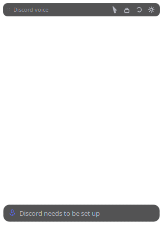
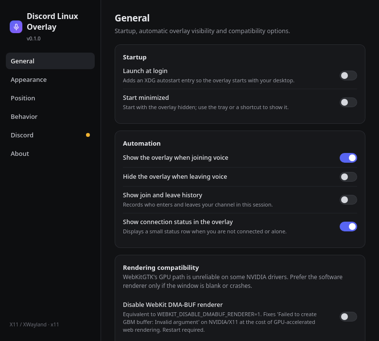
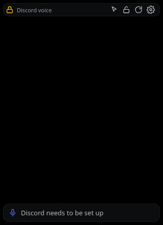

# Testing

Honest record of what was executed, on which machine, and what remains
unverified. Nothing here is marked working because a button exists.

## Environments

| | Environment | Status |
| --- | --- | --- |
| **A** | CachyOS, KDE Plasma 6 **Wayland**, NVIDIA RTX 3060 (driver 620.70.06), 6-core CPU, WebKitGTK 2.54.2, GTK 3.24.52 | **real desktop tests in §1** |
| **B** | GitHub Actions, Ubuntu 24.04, WebKitGTK 4.1 | compile/test only (§2.4) |
| **C** | Headless development container (no display, no GPU, no Discord) | browser mock only (§2.5) |

## 1. Real desktop verification — CachyOS, 2026-11-15

Built and run from this worktree on the user's real session. Nothing was
installed, no system configuration was changed, and the installed Overlayed
Flatpak was not touched.

### 1.1 Build

```sh
npm ci && npm run build
cargo build --manifest-path src-tauri/Cargo.toml --features custom-protocol
```

Result: **success**, `src-tauri/target/debug/discord-linux-overlay`, 276 MB
(debug, unstripped), 1 m 52 s from a cold `cargo` cache with all 484 crates.
No compiler warnings.

Release build: `cargo build --release --features custom-protocol` → **18 MB**
binary in 3 m 14 s. It launches, reports `visible: yes`, `size: 320x440`, and
quits cleanly through the control socket.

### 1.2 Launch — native Wayland

```sh
env -u GDK_BACKEND ./src-tauri/target/debug/discord-linux-overlay
```

The test shell exports `GDK_BACKEND=x11`, so it was unset to exercise native
Wayland; Plasma itself does not set it. Log:

```
INFO discord_linux_overlay::platform] NVIDIA + Wayland detected: setting __NV_DISABLE_EXPLICIT_SYNC=1
Gtk-WARNING: gtk_window_set_titlebar() called on a realized window
libayatana-appindicator-WARNING: libayatana-appindicator is deprecated...
```

* No `Failed to create GBM buffer`, no `Error 71`, no crash.
* `--diagnose` reported `session: wayland`, `compositor: KWin (Wayland)`,
  `toolkit backend: Wayland (native)`, `__NV_DISABLE_EXPLICIT_SYNC=1`.
* Tray initialised (the AppIndicator warning comes from a successful
  registration).

### 1.3 Windows, rendering and transparency

| Check | Evidence | Result |
| --- | --- | --- |
| No web view is created at startup | `--diagnose`: `settings window: not created`; process tree has one process | pass |
| Settings window opens on demand | `--settings` → `settings window: open`, WebKit helpers appear | pass |
| Settings window is destroyed on close | `--close-settings` → `settings window: not created`; WebKit helpers gone | pass |
| Overlay window exists and is mapped | `--diagnose`: `visible: yes`, `size: 320x440`, `renderer: native GTK/cairo` | pass |
| Transparency | KWin window capture (`spectacle -a`) → PNG `alpha=Blend, opaque=False`; center pixel `srgba(0,0,0,0)` | **pass** |
| Decorations off on Wayland | `--diagnose`: `decorated: no`, `RGBA visual: yes`; capture has no titlebar | **pass** |
| UI actually paints | same capture contains text, icons and the status row | **pass** |

Window-scoped captures (only this application's windows, not the desktop):





Captured with `spectacle -b -n -a -o …` after activating the window through a
temporary KWin script. The grey/black field is the transparent surface as stored
in the PNG (it has a real alpha channel); on the live desktop it shows the
content behind it.

**Wayland positioning limitation, observed:** KWin ignored the requested
bottom-right anchor and placed the initial window at `0,0`. This is the
documented Wayland restriction, now measured rather than assumed. After dragging
the overlay once, KWin remembers the position.

### 1.4 Controls (CLI → running instance, Wayland)

| Command | Reply | Observed effect |
| --- | --- | --- |
| `--status` | `Discord: setup required … Channel: not in a voice channel. Participants: 0.` | live state returned |
| `--toggle` (hide) | `overlay hidden` | `visible: no` |
| `--toggle` (show) | `overlay shown` | `visible: yes` |
| `--pin off` | `click-through disabled` | `configured click-through: false` |
| `--toggle-lock` | `position locked` | `locked: true` |
| `--reset-position` | `overlay position reset` | anchored/bottom-right restored in config |
| `--settings` | `settings opened` | `settings window: open` |
| `--quit` | `quitting` | process exited |
| `--diagnose` | full report | see §1.2 and §1.9 |

The control socket is `$XDG_RUNTIME_DIR/discord-linux-overlay/control.sock`; the
CLI works on Wayland where global hotkeys do not.

### 1.5 Persistence across restart

Set `clickThrough=false` and `lockPosition=true` through the CLI, quit, relaunch:

* `~/.config/discord-linux-overlay/config.json` exists with mode `0600`.
* After restart `--diagnose` reports `configured click-through: false,
  always-on-top: true, locked: true`, and the window honours them.

**pass** — configuration survives restarts.

### 1.6 System tray

`org.kde.StatusNotifierWatcher.RegisteredStatusNotifierItems` contained:

```
:1.1779 /org/ayatana/NotificationItem/tray_icon_tray_app_main
  title = discord-linux-overlay
  id    = tray-icon tray app main
```

**pass** — a StatusNotifierItem is registered with Plasma. The menu items
themselves (show/hide, click-through, settings, reset, quit) are wired to the
same `apply_request` dispatcher that the CLI exercised in §1.4, but clicking
them was **not** automated and remains unverified by hand.

### 1.7 XWayland and the NVIDIA GBM failure — reproduced

```sh
GDK_BACKEND=x11 ./src-tauri/target/debug/discord-linux-overlay
```

The first run reproduces the exact failure reported for Overlayed on this
machine:

```
Failed to create GBM buffer of size 320x440: Invalid argument
Failed to create GBM buffer of size 320x440: Invalid argument
```

The window existed (320×440, ARGB depth 32, at `3176,616` — anchoring **does**
work under XWayland, on the secondary monitor), but a window capture contained
**one colour**: the web view had painted nothing.

The two documented mitigations were then tested on the same machine:

| Mitigation | Log | Capture |
| --- | --- | --- |
| `WEBKIT_DISABLE_DMABUF_RENDERER=1` | no GBM error | 473 colours, UI rendered |
| config `general.disableDmabufRenderer=true` (no env var) | `disable_dmabuf_renderer enabled: setting WEBKIT_DISABLE_DMABUF_RENDERER=1` | 441 colours, UI rendered |



**Conclusion:** the NVIDIA/WebKitGTK DMA-BUF defect is real on this hardware and
affects this application too, not only Overlayed. On XWayland, the in-app toggle
fixes it (software rendering). On native Wayland the automatic
`__NV_DISABLE_EXPLICIT_SYNC=1` workaround was sufficient; the DMA-BUF renderer
stayed enabled.

### 1.8 Performance (idle, not connected)

#### Original WebKit overlay — baseline, 3 runs × 10 s

| Metric | Debug | Release |
| --- | --- | --- |
| CPU (one core) | 0.8 % | 0.0–0.4 % |
| Main process RSS | ~240 MB | 212 MB |
| Threads | 22 | — |
| Binary size | 276 MB | 18 MB |

Process tree (release): main 212 MB, `WebKitNetworkProcess` 65 MB, two
`WebKitWebProcess` 259 MB + 248 MB → **~785 MB summed RSS**. PSS measurement
later put the true footprint at **376.1 MiB PSS / 734.0 MiB RSS**, with the
overlay web process at 119 MiB and the hidden settings process at 114 MiB.
Creating the settings view lazily reduced this to 302 MiB, but the WebKit floor
stayed at 265 MiB even with DMA-BUF disabled. That is why the overlay was
rewritten natively.

#### Native GTK overlay — final, 3 runs × 12 s (release)

| Metric | Idle | Settings open | Just closed |
| --- | --- | --- | --- |
| Whole-tree PSS | **38.1–38.4 MiB** | 313.1–315.2 MiB | 152.4–155.2 MiB |
| Whole-tree RSS | 64.6–65.2 MiB | 511.0–513.3 MiB | 192.3–195.0 MiB |
| Private dirty | 18.4 MiB | — | — |
| Process tree | 1 process, 9 threads | 3 processes | 1 process |
| CPU (one core) | 0.00 % | — | — |
| Startup to overlay visible | 293–308 ms (median 294) | — | — |
| GPU | not listed in `nvidia-smi pmon`; no GPU context | — | — |

Five open/close cycles were flat (no leak); 20 show/hide toggles, 10 lock
toggles and pin on/off all left the process at the same footprint. A 30-minute
stability run (10 toggles at minute 5, Settings open/close at minutes 10 and 20)
held 37.86–37.87 MiB PSS before Settings and 149.8–150.6 MiB after it, with no
upward trend and 0.06% average CPU. The before/after methodology, per-run
output and the full stability table are documented in
[docs/PERFORMANCE.md](docs/PERFORMANCE.md); the memory breakdown is in
[docs/MEMORY_ANALYSIS.md](docs/MEMORY_ANALYSIS.md).

Reproduce with `./scripts/benchmark.sh --repeat 3 --duration 15`; the fast gate
is `./scripts/perf-check.sh` (PSS ≤ 200 MiB, CPU ≤ 0.8 %, startup ≤ 1500 ms).

GPU usage is **not attributable**: `nvidia-smi` only reports whole-GPU load
(other applications were using the GPU during the measurement).

CPU figures are for an idle, unconnected overlay; speaking indicators in an
active voice channel trigger event-driven repaints (not measured against real
Discord).

### 1.9 Discord — not testable in this session

* Discord was **not running**. `/run/user/1000/discord-ipc-0` exists but refuses
  connections (stale socket), which `--diagnose` reports correctly.
* No Discord application credentials are configured, so the app correctly
  reports `setup required` and does not attempt authorization.
* Consequently **no RPC handshake, OAuth approval, voice subscription,
  participants, speaking indicators, mute/deafen badges or channel switching
  were verified against real Discord.**

To finish this: start the official Discord client, create a Discord application
([docs/DISCORD_SETUP.md](docs/DISCORD_SETUP.md)), enter id + secret in
*Settings → Discord*, approve the prompt, then join a voice channel.

### 1.10 Arch package

```sh
cd packaging && makepkg -f --nodeps
```

Result: **success** — `packaging/discord-linux-overlay-git-r12.33dc13a-1-x86_64.pkg.tar.zst`,
3.97 MiB compressed, 12.12 MiB installed, 29 files:

```
usr/bin/discord-linux-overlay
usr/share/applications/io.github.polar421.DiscordLinuxOverlay.desktop
usr/share/metainfo/io.github.polar421.DiscordLinuxOverlay.metainfo.xml
usr/share/icons/hicolor/{32,64,128,256}/apps/io.github.polar421.DiscordLinuxOverlay.png
usr/share/licenses/discord-linux-overlay-git/{LICENSE,NOTICE}
```

`pacman -Qip` reports the expected name, AGPL-3.0-or-later licence, x86_64
architecture and runtime dependencies (webkit2gtk-4.1, gtk3,
libayatana-appindicator, librsvg, hicolor-icon-theme).

The packaged binary was extracted to a temporary directory and executed:
`--help`, `--diagnose` and a short native-overlay run were checked. The running
package reported `visible: yes`, `renderer: native GTK3/cairo`, `decorated:
false`, `rgba visual: true`, `settings window: not created`, 0 children and
**39,036 kB PSS / 65,908 kB RSS**; `--quit` exited cleanly. The package was
**not installed system-wide** — that would need root and the user's approval.
makepkg reports a harmless `Package contains reference to $srcdir` warning
because Rust embeds absolute source paths in panic messages; the binary is
stripped and runs normally.

First packaging attempt failed at link time with undefined `ring_core_*` symbols
because makepkg's default `lto` option passes `-flto` to the C flags used by
`ring`'s assembly objects. `packaging/PKGBUILD` now sets `options=('!lto')`; the
rebuild succeeded (6 m 29 s for the release compile inside makepkg).

## 2. Headless and CI verification

### 2.1 Core crate tests — `cargo test -p discord-overlay-core --features http`

```
62 unit tests + 5 integration tests, all passing
```

| Suite | What it proves |
| --- | --- |
| `ipc::tests` | frame encoding, fragmented reads, multiple frames per read, oversized-frame rejection, invalid JSON rejection, socket candidate discovery (native/Flatpak/Snap/`/tmp`), explicit `DISCORD_IPC_PATH` override |
| `protocol::tests` | real Discord `voice_states` payload parsing, nickname/global-name fallback, channel `type` parsing, nullable fields, RPC error-code mapping |
| `avatar::tests` | CDN URL construction, default avatar buckets, animated (`a_`) avatars, size clamping, non-numeric ids |
| `state::tests` | self-first ordering, case-insensitive sorting, mute/deafen/suppress mapping, speaking toggling without reordering, resync preserving speaking flags, removal on resync, join/leave history + cap, duplicate dedupe, channel switch clearing, disconnect reset |
| `config::tests` | defaults, clamping, missing/unknown keys, deep patch merge, round-trip on disk with `0600`, corrupt/missing file recovery, XDG path |
| `credentials::tests` | configured detection, secret never in the public view, masked id, `0600` round-trip, idempotent removal |
| `geometry::tests` | all nine anchors at 2× scale, fractional DPI, clamping oversized windows/offsets, invalid input rejection, off-screen detection and re-clamping, serialization |
| `token::tests` | form encoding, error-body reduction, truncation |
| `control::tests` | CLI switch parsing (including `--diagnose`), pin values, request serialization, socket path |
| `client::tests` | backoff capping, status serialization, private token file round-trip |
| `tests/discord_session.rs` | end-to-end over a real Unix socket against a fake Discord server: handshake → `READY` → `AUTHORIZE` → local code exchange → `AUTHENTICATE` → subscribe → channel snapshot → `SPEAKING_START`/`STOP` → `VOICE_STATE_CREATE`/`DELETE`, plus cached-token path, reconnect after the socket drops, `WaitingForDiscord` when absent, `PING`→`PONG` |

### 2.2 Front end

```sh
npx tsc --noEmit   # exit 0, strict, noUnusedLocals, verbatimModuleSyntax
npm run build      # 47 modules, dist/index.html + dist/settings.html
```

### 2.3 Dev server

`npx vite --host 0.0.0.0 --port 1420` → `GET /` and `GET /settings.html` both
HTTP 200. The browser mock harness renders the overlay and settings with
simulated participants.

### 2.4 CI (compile only)

CI run for commit `22c0714` on `main`: core tests ✓, front-end typecheck/build ✓,
`cargo build --features custom-protocol` with WebKitGTK on Ubuntu 24.04 ✓.
This proves the shell compiles and links; it does not exercise the app.

### 2.5 Browser preview (UI only)

The overlay and settings documents were rendered in the Cloud browser panel
against the mock feed: four simulated participants with one speaking ring, one
mute badge, one deafen badge, the interactive toolbar and all settings tabs.
Screenshots: `docs/screenshots/overlay.png`, `docs/screenshots/settings.png`.
This exercises React and CSS only — **not** the Tauri application.

## 3. Not executed — still unverified

| # | Item | Why |
| --- | --- | --- |
| 1 | Real Discord RPC handshake, OAuth approval, session | Discord not running; no app credentials configured |
| 2 | Real voice participants, speaking indicators, mute/deafen badges, join/leave, channel switching | requires a real voice session and a second account |
| 3 | Discord avatars through the Tauri CSP | no real session (the placeholder UI rendered) |
| 4 | Mouse dragging and resizing the overlay | not automated; positioning restrictions observed instead |
| 5 | Actual click-through (click lands on the window below) | not automated |
| 6 | KWin *Keep above* rule over a game | no KWin rule was added (requires changing the user's configuration) |
| 7 | Native Wayland multi-monitor placement | KWin ignores positioning by design; only `0,0` observed |
| 8 | Tray menu actions by mouse | SNI registration verified; menu clicks not automated |
| 9 | Global shortcuts (X11 path) | session is Wayland |
| 10 | Steam / Proton / Vulkan / OpenGL / borderless / exclusive fullscreen | no game launched |
| 11 | GPU usage attributable to the app | `nvidia-smi` only reports whole-GPU load |
| 12 | Release-build idle CPU/PSS/RSS | ✅ measured: 0.00 % CPU, 38.1 MiB PSS, 64.6 MiB RSS |
| 13 | Flatpak manifest, AppImage bundling | not attempted |
| 14 | Autostart entry, hotkey registration UI | code paths exist, not exercised |

## 4. How to finish the checklist on this machine

```sh
start Discord (official client)
./src-tauri/target/debug/discord-linux-overlay
./src-tauri/target/debug/discord-linux-overlay --diagnose     # expect "connected as …"
```

Then Settings → Discord → paste client id + secret → Save, approve the prompt in
Discord, join a channel.

| Test | Result |
| --- | --- |
| Build (debug) | ✅ 2026-11-15 |
| Launch (Wayland) | ✅ 2026-11-15 |
| Launch (XWayland `GDK_BACKEND=x11`) | ✅ (blank without mitigation, rendered with it) |
| Transparency | ✅ alpha channel verified |
| Settings window opens | ✅ |
| Overlay hide/show/pin/lock/reset/status/quit via CLI | ✅ |
| Settings persistence | ✅ |
| Tray registration | ✅ (menu clicks untested) |
| Discord auth | ☐ |
| Participants + speaking | ☐ |
| Mute/deafen | ☐ |
| Join/leave/channel switch | ☐ |
| Drag/resize | ☐ |
| Click-through | ☐ |
| Always-on-top (KWin rule) | ☐ |
| Multi-monitor (native Wayland) | ☐ (XWayland anchoring verified) |
| Shortcuts / CLI | ✅ CLI; hotkeys ☐ |
| Borderless game | ☐ |
| Exclusive fullscreen | ☐ (expected: no overlay) |
| Idle CPU / GPU | ✅ release CPU 0.00 %; GPU not attributable (no GPU context) |
| Native overlay memory | ✅ 38.1 MiB PSS / 65.0 MiB RSS idle |
| Settings open/close memory | ✅ 313 MiB open, ~153 MiB after close, stable over 5 cycles |
